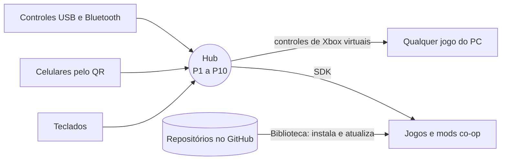
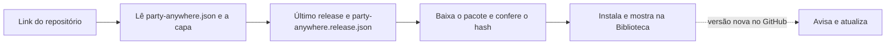

# Party Anywhere

**Qualquer jogo. Qualquer controle. Até 10 pessoas no mesmo sofá.**

Party Anywhere junta todo mundo num lobby só, no PC com Windows. Pode ser controle com fio ou Bluetooth,
celular (escaneando um QR, sem instalar app) ou teclado: cada pessoa vira um jogador, de **P1 a P10**.

São três peças que conversam entre si:

| | O que é | Para quem |
|---|---|---|
| 🎮 **Hub** | O app que reúne os controles e abre os jogos. | Quem joga |
| 🧩 **SDK** | Um arquivo (`party_anywhere.h`) que deixa um jogo ou mod ler os jogadores do Hub. | Quem cria |
| 📚 **Biblioteca** | Jogos co-op publicados no GitHub. Cole o link e o jogo instala, com capa e atualizações. | Os dois |



## Jogar

1. Baixe e instale o `PartyAnywhere-X.Y.Z-setup.exe` da página de **Releases**.
2. Ligue os controles ou escaneie o QR com o celular (no mesmo Wi-Fi do PC). Cada um vira um jogador.
3. Na **Biblioteca**, escolha o jogo e aperte **Jogar**.

Só isso. O Hub se atualiza sozinho e avisa quando um jogo instalado ganha versão nova.

- **Jogos comuns** (Steam, Epic, qualquer `.exe`): celulares e teclados aparecem como controles de Xbox.
  Na primeira vez o Hub pede para instalar um componente gratuito do Windows (ViGEmBus).
- **Jogos feitos para o Party Anywhere**: cada jogador chega pronto, com nome e cor, sem configurar nada.
- **Um jogo co-op que alguém publicou**: Biblioteca → Adicionar → cole o link do repositório.

## Criar um jogo co-op

Você pode criar um jogo novo ou transformar um jogo que já tem no PC em co-op (um mod). Nos dois casos o
jogo lê os jogadores pelo SDK e o Hub cuida de controles, celulares, lobby, instalação e atualização.

### Com um agente de IA (o jeito mais fácil)

A ferramenta `pa` traz um servidor **MCP**: um programinha que roda no seu computador e dá ao agente
(Claude Code, Cursor e outros) as ferramentas do Party Anywhere. Não tem servidor na internet nem custo.

1. Baixe o `pa.exe` da página de **Releases** e coloque numa pasta do `PATH`.
2. Ligue o `pa` ao seu agente. No Claude Code:

   ```bash
   claude mcp add --scope user party-anywhere -- pa mcp
   ```

   Em outros agentes, a configuração é sempre a mesma: comando `pa`, argumento `mcp`.
3. Peça em palavras, por exemplo: *"transforme o jogo X em co-op para o Party Anywhere"*.

O agente confere se o Hub está instalado e atualizado (e instala, se precisar), acha o jogo no seu PC
(Steam e Epic), cria o projeto já preenchido, lê a documentação do SDK, valida e prepara a publicação.

| Ferramenta do MCP | O que faz |
|---|---|
| `hub_status`, `install_hub` | O Hub está instalado e atualizado? Instala ou atualiza. |
| `find_installed_games` | Jogos do PC que podem virar co-op (avisa os que têm anti-cheat). |
| `create_game` | Cria o projeto: manifesto, capa provisória, SDK com exemplo, workflow de publicação. |
| `get_sdk_docs`, `get_manifest_spec` | A documentação, para o agente escrever o código certo. |
| `validate_game`, `pack_release` | Confere tudo e gera o pacote da versão. |
| `inspect_published_game` | Lê o jogo publicado como o Hub vai ler e diz se instala. |

### Na mão, pelo terminal

```bash
pa new meu-jogo --name "Meu Jogo"
```

Para o mod de um jogo instalado: `pa new meu-mod --name "Meu Mod" --base-game "nome do jogo"`.
Depois: `pa validate` confere, `pa pack --from build --tag v0.1.0` gera a versão e `pa inspect dono/repo`
mostra como o Hub lê o que você publicou. `pa games` lista os jogos do PC e `pa hub` confere o Hub.

### O código do jogo

```c
#define PARTY_ANYWHERE_IMPLEMENTATION
#include "party_anywhere.h"

pa_game_info info = { sizeof info, "com.voce.meu-jogo", "Meu Jogo", 1, 10 };
pa_client *pa;
pa_connect(&info, &pa);

/* a cada frame */
pa_poll(pa);
for (int seat = 0; seat < PA_MAX_SEATS; seat++) {
    pa_pad pad;
    if (pa_get_pad(pa, seat, &pad) && (pad.pressed & PA_BTN_A)) {
        pa_rumble(pa, seat, 0.8f, 0.8f, 80); /* o jogador seat + 1 apertou A: o controle dele vibra */
    }
}
```

Um arquivo só, em C, para C e C++ (x86 e x64). Sem o Hub aberto, `pa_connect` avisa e o jogo segue com os próprios controles.
Tudo em [docs/SDK.md](docs/SDK.md).

## Regras para o Hub achar, instalar e atualizar o seu jogo

O Hub lê o repositório sozinho. Para isso funcionar, o jogo segue este contrato (o `pa new` já cria assim e
o `pa validate` avisa o que faltar):

- [ ] **`party-anywhere.json` na raiz do repositório**: nome, frase curta, número de jogadores (1 a 10),
      como instalar e como abrir. Especificação: [docs/GAME-MANIFEST.md](docs/GAME-MANIFEST.md).
- [ ] **Uma capa** em retrato (3:4, a partir de 600×800). Arte sua, sem a arte oficial de outro jogo.
- [ ] **Cada versão é um release do GitHub** com a tag igual à `version` (ex.: `v0.1.0`), o pacote `.zip`
      e o `party-anywhere.release.json` que o `pa pack` gera (com o hash do pacote).
- [ ] **Repositório público**, para qualquer pessoa instalar pelo link.
- [ ] **Tópico `party-anywhere-game`** no repositório, para aparecer em "Descobrir" no Hub.
- [ ] **Sem arquivos do jogo original** no repositório nem no pacote: o mod usa a cópia que a pessoa já tem.
- [ ] **Sem jogos com anti-cheat**: contornar anti-cheat está fora do projeto e pode banir quem joga.

Como o Hub lê um jogo:



Se algo não bater (sem capa, hash diferente, versão errada), nada é instalado e o Hub explica o que fazer.

## Colaborar

Ideias, bugs e jogos novos são bem-vindos.

- **Publicou um jogo?** Abra uma issue com o link: ele pode entrar no catálogo com o selo **Verificado**.
- **Achou um problema?** Abra uma issue contando o que fez, o que esperava e o que aconteceu.
- **Quer mexer no código?** Faça um fork, crie um branch e abra um pull request. Antes, rode:

  ```bash
  cargo test --workspace
  cargo clippy --workspace --all-targets -- -D warnings
  ```

  Combinados: textos da interface e docs em português do Brasil; código e commits em inglês. Mudou o
  protocolo do celular, o SDK ou o manifesto? Atualize o doc no mesmo pull request.

## Desenvolver o Hub

Requisitos: Windows 10 ou 11, Rust estável e Node 22 (só para gerar o instalador).

```bash
cargo run -p party-anywhere-hub
```

A interface (`apps/hub/ui`) também abre no navegador, em modo demonstração, com o painel "Demo":

```bash
python -m http.server 5173 --directory apps/hub/ui
```

A ferramenta `pa`, direto do código:

```bash
cargo install --path crates/pa-cli
```

Gerar o instalador (sai em `target/release/bundle/nsis/`), dentro de `apps/hub/src-tauri`:

```bash
npx --yes @tauri-apps/cli@2 build
```

Uma tag `vX.Y.Z` publica o instalador e o `pa.exe` pelo workflow `.github/workflows/release.yml`.

| Pasta | O que tem |
|---|---|
| `apps/hub` | O app (Tauri 2): `src-tauri` em Rust, `ui` em HTML e JS |
| `crates/` | Lobby, celular, controles virtuais, SDK, manifesto, Biblioteca e a ferramenta `pa` |
| `sdk/c` | `party_anywhere.h` e um exemplo |
| `templates/game` | O projeto modelo que o `pa new` cria |
| `schema/` | O esquema JSON do manifesto (autocompletar no editor) |

## Licença

[MIT](LICENSE).
