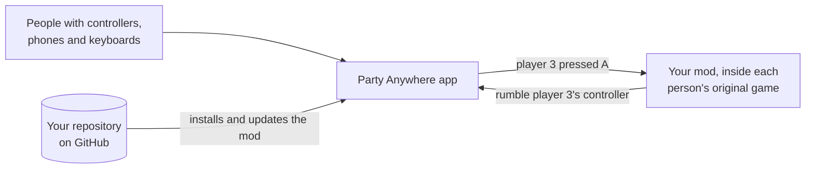

<p align="center">
  <picture>
    <source media="(prefers-color-scheme: dark)" srcset="assets/brand/logo-stacked-dark.png">
    
  </picture>
</p>

<p align="center"><b>Any game. Any controller. Up to 10 people on the same couch.</b></p>

<p align="center">
  <a href="https://github.com/joaocaioo/party-anywhere/releases/latest"></a>
  <br>
  <a href="https://github.com/joaocaioo/party-anywhere/releases/latest"></a>
</p>

<p align="center">
  <b>English</b> · <a href="README.pt-BR.md">Português (Brasil)</a>
</p>

<p align="center">
  <a href="#play">Play</a> ·
  <a href="#co-op-mods-you-can-play-today">Mods</a> ·
  <a href="#turn-a-game-into-local-co-op">Make a mod</a> ·
  <a href="#quick-questions">Questions</a> ·
  <a href="#contribute">Contribute</a>
</p>

---

## What it is

Getting friends together to play on a PC is usually a hassle: not enough controllers, one won't connect, the
game only has online co-op. **Party Anywhere** fixes that. It's a Windows app that puts everyone in one lobby
and opens games (and co-op mods made by the community) so everybody can play together on the same PC:

- 🎮 **Controller**, wired or Bluetooth: turn it on and you're in.
- 📱 **Phone**: scan a QR code and it becomes a controller. Nothing to install.
- ⌨️ **Keyboard**: even the laptop's one counts.

Each person becomes a player, from **P1 to P10**, with their own color. Then just pick the game.

The app is in **English and Brazilian Portuguese**: pick the language in the installer, or switch any time with
the small **EN / PT** button at the top of the app.

> **For now, it's local co-op:** everyone in the same place, on the same screen (or split screen), with the
> phones on the same Wi-Fi as the PC. Playing over the internet isn't part of this version.

<p align="center">
  
</p>

## Play

1. Click **[Download for Windows](https://github.com/joaocaioo/party-anywhere/releases/latest)**, download
   **`PartyAnywhere-X.Y.Z-setup.exe`** (the newest version) and open it. The installer asks for the language.
   If Windows shows "Windows protected your PC", it's because the installer isn't digitally signed yet: click
   **More info** → **Run anyway**.
2. Open the app. Turn on the controllers or scan the QR code with your phone (on the same Wi-Fi as the PC).
3. Go to **Library**, pick the game and press **Play**.

That's it. The app updates itself and lets you know when a game gets a new version.

<p align="center">
  
</p>

| What you want | How it works |
|---|---|
| Play a game that already supports several controllers, using phones and keyboards | Open the game from the Library (Steam, Epic or any `.exe`): phones and keyboards show up to it as Xbox controllers. |
| Play a **co-op mod** someone made for a game you own | Library → **Add** → paste the repository link. The app finds your game, installs the mod and gets it ready to play. |

> **How many players, in each case.** Most regular games see **up to 4** Xbox controllers: that's a Windows
> limit, not the app's. **From 5 to 10 players**, only with a co-op mod (or a game that accepts more
> controllers). And in a regular game, the game itself also reads the PC keyboard: keyboard as a player works
> best in mods.

<details>
<summary><b>Installing with an AI agent (Claude Code and others)</b></summary>

If you ask an agent to install Party Anywhere for you, it should **ask which language you want (English or
Português)** and then install silently with that choice. Instructions for the agent, in PowerShell:

```powershell
$r = Invoke-RestMethod https://api.github.com/repos/joaocaioo/party-anywhere/releases/latest
$a = $r.assets | Where-Object name -like '*-setup.exe' | Select-Object -First 1
Invoke-WebRequest $a.browser_download_url -OutFile "$env:TEMP\$($a.name)"
Start-Process "$env:TEMP\$($a.name)" -ArgumentList '/S', '/LANG=en' -Wait   # or /LANG=pt-BR
```

A silent install skips the one-time Windows permission (phones on the Wi-Fi and the virtual-controller
component); the app offers it again the first time it's needed.
</details>

### Installing a mod: what happens

A co-op mod is what transforms the game, not the game itself. It runs on top of **your copy** of the original
game. Nobody can distribute another company's game, neither the mod author nor Party Anywhere. You paste the
link and the app does the rest:

1. **Looks for your game** on Steam, Epic and the games on your PC.
2. **Didn't find it?** It shows the ways forward: **install from Steam** or **from Epic** (the app waits for it
   to finish and carries on by itself), **see it in the store**, or **"I already have it"**: you point to the
   game's `.exe` or folder, wherever it came from (GOG, CD, another folder).
3. **Checks the game version** when the mod needs a specific one, and tells you what to do if it doesn't match.
4. **Installs the mod** in the game folder, keeping the original files. Removing the mod puts everything back.
5. **Done:** the game shows up in the Library. Press **Play** and it opens in local co-op.

---

## Co-op mods you can play today

Official mods live in the **[party-anywhere](https://github.com/party-anywhere)** organization on GitHub. In
the app: Library → **Add** → **Add by link** and paste the link. You need your own copy of the original game.

| Mod | What it does | Players |
|---|---|---|
| **[PEAK Co-op Local](https://github.com/party-anywhere/peak-coop)** | [PEAK](https://store.steampowered.com/app/3527290/) in local co-op on the same PC: split screen, with each climber's own HUD, inventory and camera. | 1 to 10 |
| **[MicroWorks Co-op Local](https://github.com/party-anywhere/microworks-coop)** | [MicroWorks](https://store.steampowered.com/app/1233410/) in local co-op on the same PC: split screen, with each player's own HUD, scoreboard and controls (or play on the phone). | 1 to 10 |

**Want to find more?** Every community mod carries the
**[`party-anywhere-game`](https://github.com/topics/party-anywhere-game)** topic on GitHub: that page lists
everything available. The app also links to both pages right below the link field, under **Add by link**.

---

## Turn a game into local co-op

### What for

Lots of great games have **online-only co-op**, each person on their own PC, or are single-player. A local
co-op mod makes that game run with **several people on the same PC**: split screen, each with a controller or
a phone, **the way you decide** (how many players, how the camera works, what each one controls).

You publish the mod in a GitHub repository. Anyone who owns the game pastes the link into the app and plays.

> **The idea in one sentence:** Party Anywhere takes care of the people and the controllers. Your mod only
> asks: *"what is player 3 pressing?"*



You don't write anything about controllers, Bluetooth, phones or lobbies. The mod reads the players through a
ready-made file (the **SDK**), and the app installs, updates and launches it.

**What's up to you, and it's the big part:** making the game have the extra players and split the screen. That
changes from game to game: in a game with modding tools it's simpler; in a closed game it's reverse
engineering (finding where the game keeps the players and the camera). The
[local co-op guide](docs/MOD-COOP-LOCAL.md) (in Portuguese) shows the paths, including how to reuse the
multiplayer the game already has.

> The detailed docs in [`docs/`](docs) are written in Brazilian Portuguese. They read fine through a browser
> translator, and your AI agent reads them directly.

### In 5 steps

#### 1. Get the `pa` tool

Download **`pa.exe`** from the [Releases](../../releases) page and put it in a folder on your `PATH`. It
creates, checks and packages the mod for you.

#### 2. Create the mod project

With the game installed on your PC:

```bash
pa new my-mod --name "My Co-op Mod" --base-game "game name"
```

The tool finds the game (Steam or Epic; from anywhere else, pass its folder or `.exe`) and fills in the
manifest with it: the name, the executable and where it comes from. That way the app of whoever downloads it
knows where to look and, if needed, how to help them install it. You get:

| File | What it's for |
|---|---|
| `party-anywhere.json` | The mod's "manifest": name, how many players, which is the original game, what to copy into its folder, and the game's phone controller (one comes included, with the middle of the screen free). It's what the app reads. |
| `assets/cover.png` | The cover in the Library. A placeholder comes included; replace it with yours (3:4 portrait, your own art). |
| `sdk/party_anywhere.h` | The SDK: the file the mod includes to read the players. |
| `.github/workflows/release.yml` | Publishes each version by itself when you create a tag. |
| `AGENTS.md`, `CLAUDE.md` and `.claude/` | Instructions for AI agents (see below). |

#### 3. Write the mod

The mod runs inside the game (for example, a DLL the game loads). How you get into each game varies, but the
player part is always the same: a single C file that works in C and C++.

```c
#define PARTY_ANYWHERE_IMPLEMENTATION
#include "party_anywhere.h"

// 1. Connect to the app, once, when the game opens
pa_game_info info = { sizeof info, "com.you.my-mod", "My Co-op Mod", 1, 4 };
pa_client *pa;
pa_connect(&info, &pa);

// 2. Every game frame, read the players
pa_poll(pa);
for (int player = 0; player < PA_MAX_SEATS; player++) {
    pa_pad pad;
    if (pa_get_pad(pa, player, &pad) && (pad.pressed & PA_BTN_A)) {
        // the player pressed A: make their character jump
        pa_rumble(pa, player, 0.8f, 0.8f, 80); // and their controller rumbles
    }
}
```

You can also know who joined or left, each person's name and color, send a notice to someone's phone, and pause
when a player drops. All of it in [docs/SDK.md](docs/SDK.md).

**Your game's phone controller:** build it in the app (Controls → Create layout), with a name for each button
("Jump", "Boost") and modes if the game changes controls (on foot and in the car), and copy it into the
manifest. When the mod opens, the phones switch to it by themselves. How: [docs/GAME-MANIFEST.md](docs/GAME-MANIFEST.md).

#### 4. Test with the app open

Open Party Anywhere, join with a controller and a phone, and open the game with the mod. Before publishing:

```bash
pa validate
```

It checks the manifest and the cover and tells you what to fix. To play your mod **without publishing**,
build the package and bring the folder into the Library:

```bash
pa pack --from build
```

```bash
pa add .
```

#### 5. Publish (optional, but it gets your mod to everyone)

1. Push the project to a **public** GitHub repository (just the mod: nothing from the original game).
2. In `release.yml`, replace the **Build** step with the way your mod is compiled.
3. Create the version tag, matching the manifest's `version`:

   ```bash
   git tag v0.1.0
   git push --tags
   ```

4. **Add the `party-anywhere-game` topic** to the repository (on its page, under "About" → ⚙️ → Topics).

GitHub publishes the version by itself. From then on, anyone pastes the link into the Library and plays, and
your mod shows up on the **[party-anywhere-game topic page](https://github.com/topics/party-anywhere-game)**,
which the app links to. New version? Bump `version`, create the new tag and everyone who installed it gets
notified.

> **Want your mod in the organization?** Mods can live in your own account, that's fine. If you'd rather have
> it next to the official ones in **[party-anywhere](https://github.com/party-anywhere)** (more visibility and
> help maintaining it), [open an issue](https://github.com/joaocaioo/party-anywhere/issues/new) with the link
> to your mod and we'll talk about moving it or inviting you to the organization.

### With an AI agent

Open your agent (Claude Code, Cursor, Codex and others) in the mod folder. **No setup needed:** the project
comes with an `AGENTS.md` that teaches the agent to use `pa` and to read its documentation (`pa docs`). Ask for
one thing at a time:

- *"I want game X in local co-op for 4. Read the co-op guide and propose the path."*
- *"First step: the mod loads in the game and sends a notice to the phone."*
- *"Build the phone controller for this mod: on foot and in the car."*
- *"Is my mod ready to publish?"*

The agent really helps with the Party Anywhere part (project, controllers, phone, manifest, publishing) and is
a good partner on the game part, but that part is done back and forth with you, testing each step. It asks your
permission before installing anything.

<details>
<summary>Agent without a terminal (Claude Desktop and others): MCP server</summary>

`pa` is also an MCP server, with the same tools, running on your PC (no server on the internet). In Claude Code,
if you prefer:

```bash
claude mcp add --scope user party-anywhere -- pa mcp
```

In other agents, configure an MCP server with the command `pa` and the argument `mcp`.
</details>

### What the app needs to find and install your mod

The app reads your repository by itself. `pa new` already sets everything up like this and `pa validate` warns
about anything missing:

- [ ] `party-anywhere.json` at the root of the repository ([how to fill it in](docs/GAME-MANIFEST.md)), saying
      which is the original game (the executable and, if it has one, its Steam or Epic ID).
- [ ] Portrait cover (3:4, from 600×800 up), with your own art.
- [ ] Each version is a GitHub release with the tag equal to `version` (e.g. `v0.1.0`), with the `.zip` package
      and `party-anywhere.release.json` (the workflow generates both).
- [ ] Public repository, with the `party-anywhere-game` topic.
- [ ] **No files from the original game** in the repository or the package.
- [ ] No games with anti-cheat (bypassing anti-cheat can get players banned).

At install time, the app checks everything. If something doesn't match, nothing is installed and the message
says what to do.

> **What about a brand-new game?** That works too: `pa new my-game --name "My Game"` (without `--base-game`)
> creates a game that's born local co-op. It comes whole in the package, no other game needed.

---

## Quick questions

**Do I need the original game to play a mod?** Yes: the mod runs on top of your copy. The app looks on Steam
and Epic and, if it doesn't find it, helps you install it or lets you point to the folder.

**I bought the game outside Steam and Epic. Does it work?** It does: choose the game's `.exe` or folder when
the app asks. If the mod needs a specific version, the app tells you.

**Do I need to pay or run a server?** No. The app, `pa` and the MCP run on your PC, and GitHub hosts the mods
for free.

**Does it work over the internet?** No. It's local co-op: everyone in the same place, phones on the same Wi-Fi
as the PC.

**How many players?** From 1 to 10. The mod says how many it accepts in the manifest; if there are more people,
the app asks who's playing.

**Which language can I use?** C and C++ (`party_anywhere.h`) and C# (`PartyAnywhere.cs`, for Unity with BepInEx
or MelonLoader). `pa new` includes both.

**Is there lag on phones?** Very little: on a home network, a touch reaches the PC in about 25 ms.

**Can I mod any game?** Games without anti-cheat, and without distributing files from the original game.

**Is it safe to install a mod?** A mod is a program: it runs on your PC, inside the game. Only install from
people you trust, as you would with any mod. The app checks that the package is exactly what was published (by
hash), only writes to the game folder and the app's own folder, keeps the original files and restores
everything on removal. Found a malicious mod? Open an issue with the link.

---

## Contribute

All help is welcome, from players and from programmers.

- **Published a mod?** With the `party-anywhere-game` topic it already shows up on the
  [topic page](https://github.com/topics/party-anywhere-game). Want it in the
  [organization](https://github.com/party-anywhere) or want to spread the word? Open an issue with the link.
- **Found a problem?** Open an issue telling what you did, what you expected and what happened.
- **Have an idea?** Open an issue: the next priorities come from what people ask for.
- **Want to work on the code?** Fork, create a branch and open a pull request.

Conventions: the app's texts and the docs are written in Brazilian Portuguese, and the app's English comes from
`apps/hub/ui/i18n-en.js` (new UI text needs its English entry there); this README exists in both languages. Code
and commits in English. Changed the phone protocol, the SDK or the game manifest? Update the doc in the same
pull request.

<details>
<summary><b>Developing the app</b></summary>

Requirements: Windows 10 or 11, stable Rust and Node 22 (only to build the installer).

```bash
cargo run -p party-anywhere-hub
```

The interface also opens in the browser, in demo mode (with the "Demo" panel to simulate phones and
controllers):

```bash
python -m http.server 5173 --directory apps/hub/ui
```

Tests, before opening a pull request:

```bash
cargo test --workspace
```

```bash
cargo clippy --workspace --all-targets -- -D warnings
```

`pa` straight from the source:

```bash
cargo install --path crates/pa-cli
```

Building the installer (output in `target/release/bundle/nsis/`), inside `apps/hub/src-tauri`:

```bash
npx --yes @tauri-apps/cli@2 build
```

A `vX.Y.Z` tag publishes the installer and `pa` through the `.github/workflows/release.yml` workflow.

| Folder | What's in it |
|---|---|
| `apps/hub` | The app (Tauri 2): `src-tauri` in Rust, `ui` in HTML and JS |
| `crates/` | Lobby, phone, virtual controllers, SDK, game manifest, Library and `pa` |
| `sdk/c` | `party_anywhere.h` and the example |
| `templates/game` | The template project `pa new` creates |
| `schema/` | The manifest schema (editor autocomplete) |
| `assets/brand` | Brand: mascot, app icon and the stacked and horizontal logo, for dark and light backgrounds |

</details>

## License

[MIT](LICENSE).
