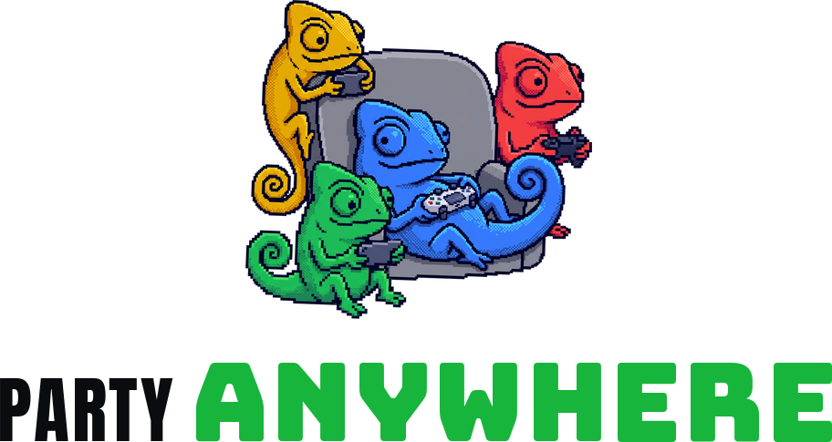
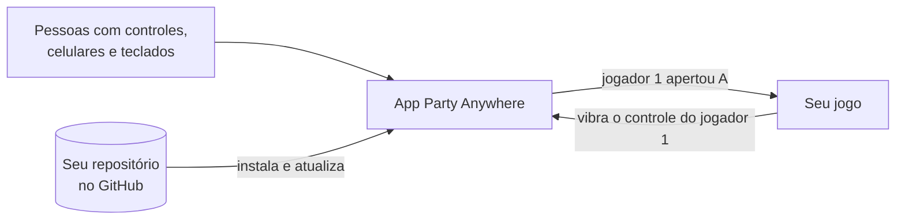

<p align="center">
  <picture>
    <source media="(prefers-color-scheme: dark)" srcset="assets/brand/logo-stacked-dark.png">
    
  </picture>
</p>

<p align="center"><b>Qualquer jogo. Qualquer controle. Até 10 pessoas no mesmo sofá.</b></p>

<p align="center">
  <a href="#jogar">Jogar</a> ·
  <a href="#criar-um-jogo-co-op">Criar um jogo</a> ·
  <a href="#perguntas-rápidas">Perguntas</a> ·
  <a href="#colaborar">Colaborar</a>
</p>

---

## O que é

Juntar a galera para jogar no PC costuma dar trabalho: falta controle, um não conecta, o jogo só aceita
dois. O **Party Anywhere** resolve isso. É um app para Windows que coloca todo mundo num lobby só:

- 🎮 **Controle** com fio ou Bluetooth: liga e já entra.
- 📱 **Celular**: escaneia um QR e vira controle. Sem instalar nada.
- ⌨️ **Teclado**: até o do notebook vale.

Cada pessoa vira um jogador, de **P1 a P10**, com a sua cor. Depois é só escolher o jogo.

> **Por enquanto, é co-op local:** todo mundo no mesmo lugar, na mesma tela (ou em tela dividida), com os
> celulares no mesmo Wi-Fi do PC. Jogar pela internet não faz parte desta versão.

<p align="center">
  
</p>

## Jogar

1. Baixe e instale o **`PartyAnywhere-X.Y.Z-setup.exe`** (a versão mais nova) na página de [Releases](../../releases).
2. Abra o app. Ligue os controles ou escaneie o QR com o celular (no mesmo Wi-Fi do PC).
3. Vá em **Biblioteca**, escolha o jogo e aperte **Jogar**.

Pronto. O app se atualiza sozinho e avisa quando um jogo ganha versão nova.

<p align="center">
  
</p>

| Que tipo de jogo | Como funciona |
|---|---|
| Jogos que você já tem (Steam, Epic, qualquer `.exe`) | Celulares e teclados aparecem para o jogo como controles de Xbox. O instalador já oferece o componente gratuito do Windows que faz isso funcionar. |
| Jogos e mods feitos para o Party Anywhere | Cada jogador chega pronto, com nome e cor. Nada para configurar. |
| Um jogo que alguém publicou no GitHub | Biblioteca → **Adicionar** → cole o link. Ele instala com capa e se atualiza sozinho. |

---

## Criar um jogo co-op

### A ideia em uma frase

> **O Party Anywhere cuida das pessoas e dos controles. O seu jogo só pergunta: "o que o jogador 3 está apertando?"**

Você não escreve nada de controle, Bluetooth, celular ou lobby. O app faz isso. O seu jogo usa um arquivo
pronto (o **SDK**) para ler os jogadores, e o **GitHub** guarda e distribui o jogo.



Dá para fazer de dois jeitos:

- **Um jogo novo**, do zero.
- **Um mod co-op de um jogo que você já tem** (por exemplo, colocar 4 pessoas num jogo que era de 1).
  O mod usa a cópia do jogo que cada pessoa já tem no PC. Você nunca distribui o jogo original.

### Do zero à Biblioteca em 5 passos

#### 1. Pegue a ferramenta `pa`

Baixe o **`pa.exe`** na página de [Releases](../../releases) e coloque numa pasta que esteja no `PATH`
(ou na pasta onde você vai trabalhar). Ela cria, confere e empacota o jogo para você.

#### 2. Crie o projeto

Jogo novo:

```bash
pa new meu-jogo --name "Meu Jogo"
```

Mod de um jogo que está no seu PC (a ferramenta acha o jogo na Steam ou na Epic):

```bash
pa new meu-mod --name "Meu Mod" --base-game "nome do jogo"
```

Você ganha uma pasta já pronta para publicar:

| Arquivo | Para que serve |
|---|---|
| `party-anywhere.json` | A "ficha" do jogo: nome, frase curta, quantos jogadores, como instalar e abrir. É o que o app lê. |
| `assets/cover.png` | A capa na Biblioteca. Vem uma provisória; troque pela sua (retrato 3:4). |
| `sdk/party_anywhere.h` | O SDK: o arquivo que o seu jogo inclui para ler os jogadores. |
| `sdk/examples/arena_console.c` | Um jogo de exemplo, pequeno, para copiar e adaptar. |
| `.github/workflows/release.yml` | Publica cada versão sozinho quando você cria uma tag. |
| `.mcp.json` e `.claude/` | Atalhos para agentes de IA (veja abaixo). |

#### 3. Escreva o jogo

O SDK é **um arquivo só**, em C, que funciona em C e C++. O essencial cabe aqui:

```c
#define PARTY_ANYWHERE_IMPLEMENTATION
#include "party_anywhere.h"

// 1. Conecte ao app, uma vez, quando o jogo abre
pa_game_info info = { sizeof info, "com.voce.meu-jogo", "Meu Jogo", 1, 10 };
pa_client *pa;
pa_connect(&info, &pa);

// 2. A cada frame, leia os jogadores
pa_poll(pa);
for (int jogador = 0; jogador < PA_MAX_SEATS; jogador++) {
    pa_pad pad;
    if (pa_get_pad(pa, jogador, &pad) && (pad.pressed & PA_BTN_A)) {
        // o jogador apertou A: faça ele pular
        pa_rumble(pa, jogador, 0.8f, 0.8f, 80); // e o controle dele vibra
    }
}
```

Também dá para: saber quem entrou ou saiu, o nome e a cor de cada um, mandar um aviso para o celular de
alguém e pausar quando um jogador cai. Tudo explicado em [docs/SDK.md](docs/SDK.md).

#### 4. Teste com o app aberto

Abra o Party Anywhere, entre com um controle e um celular e rode o seu jogo. Os jogadores do lobby
aparecem no jogo na hora. Antes de publicar, rode:

```bash
pa validate
```

Ele confere a ficha e a capa e diz, em português, o que ajustar.

#### 5. Publique

1. Suba o projeto para um repositório **público** no GitHub.
2. No `release.yml`, troque o passo **Build** pelo jeito de compilar o seu jogo.
3. Crie a tag da versão, igual à `version` da ficha:

   ```bash
   git tag v0.1.0
   git push --tags
   ```

4. Adicione o tópico **`party-anywhere-game`** ao repositório (na página dele, em "About").

O GitHub publica a versão sozinho. A partir daí, qualquer pessoa cola o link na Biblioteca e instala, e o
seu jogo aparece em **Descobrir**. Versão nova? Suba a `version`, crie a tag nova e quem já instalou recebe
o aviso de atualização.

### Com um agente de IA

Prefere pedir em vez de fazer? A `pa` traz um servidor **MCP**, que entrega ao seu agente (Claude Code,
Cursor e outros) as ferramentas do Party Anywhere. Ele roda no seu computador: **sem servidor na internet
e sem custo**.

Ligue uma vez. No Claude Code:

```bash
claude mcp add --scope user party-anywhere -- pa mcp
```

Em outros agentes, configure um servidor MCP com o comando `pa` e o argumento `mcp`.

Depois é só pedir, por exemplo:

- *"Transforme o jogo X em co-op para o Party Anywhere."*
- *"Crie um jogo de corrida para até 8 pessoas usando o Party Anywhere."*
- *"Meu jogo está pronto para publicar?"*

O agente confere se o app está instalado e atualizado, acha o jogo no seu PC, cria o projeto, lê a
documentação do SDK, valida e prepara a publicação. Ele pede sua permissão antes de instalar qualquer coisa.

### O que o app exige para achar e instalar o seu jogo

O app lê o seu repositório sozinho, então o jogo segue estas regras. O `pa new` já cria tudo assim e o
`pa validate` avisa o que faltar.

- [ ] `party-anywhere.json` na raiz do repositório ([como preencher](docs/GAME-MANIFEST.md)).
- [ ] Capa em retrato (3:4, a partir de 600×800), com arte sua.
- [ ] Cada versão é um release do GitHub com a tag igual à `version` (ex.: `v0.1.0`).
- [ ] O release tem o pacote `.zip` e o `party-anywhere.release.json` (o workflow gera os dois).
- [ ] Repositório público, com o tópico `party-anywhere-game`.
- [ ] Nenhum arquivo do jogo original no repositório ou no pacote.
- [ ] Nada de jogos com anti-cheat (contornar anti-cheat pode banir quem joga).

Na hora de instalar, o app confere tudo. Se algo não bater (sem capa, pacote diferente do publicado,
versão errada), nada é instalado e a mensagem diz o que fazer.

---

## Perguntas rápidas

**Preciso pagar ou manter um servidor?** Não. O app, a `pa` e o MCP rodam no seu PC, e o GitHub hospeda
os jogos de graça.

**Funciona pela internet?** Não. É co-op local: todo mundo no mesmo lugar, celulares no mesmo Wi-Fi do PC.

**Quantos jogadores?** De 1 a 10. O seu jogo diz quantos aceita na ficha.

**Que linguagem posso usar?** C ou C++ hoje. Outras linguagens e motores (Unity, Godot) estão nos planos.

**Meu jogo funciona sem o app aberto?** Funciona: o `pa_connect` avisa que o app não está aberto e o jogo
segue com os próprios controles.

**Os celulares têm atraso?** Pouco: na rede de casa, o toque chega ao PC em cerca de 25 ms.

**Posso fazer mod de qualquer jogo?** De jogos sem anti-cheat, e sem distribuir arquivos do jogo original.

---

## Colaborar

Toda ajuda é bem-vinda, de quem joga e de quem programa.

- **Publicou um jogo?** Abra uma issue com o link. Ele pode entrar no catálogo com o selo **Verificado**.
- **Achou um problema?** Abra uma issue contando o que fez, o que esperava e o que aconteceu.
- **Tem uma ideia?** Abra uma issue: as próximas prioridades saem do que as pessoas pedem.
- **Quer mexer no código?** Faça um fork, crie um branch e abra um pull request.

Combinados: textos do app e docs em português do Brasil; código e commits em inglês. Mudou o protocolo do
celular, o SDK ou a ficha do jogo? Atualize o doc no mesmo pull request.

<details>
<summary><b>Desenvolver o app</b></summary>

Requisitos: Windows 10 ou 11, Rust estável e Node 22 (só para gerar o instalador).

```bash
cargo run -p party-anywhere-hub
```

A interface também abre no navegador, em modo demonstração (com o painel "Demo" para simular celulares e
controles):

```bash
python -m http.server 5173 --directory apps/hub/ui
```

Testes, antes de abrir um pull request:

```bash
cargo test --workspace
```

```bash
cargo clippy --workspace --all-targets -- -D warnings
```

A `pa` direto do código:

```bash
cargo install --path crates/pa-cli
```

Gerar o instalador (sai em `target/release/bundle/nsis/`), dentro de `apps/hub/src-tauri`:

```bash
npx --yes @tauri-apps/cli@2 build
```

Uma tag `vX.Y.Z` publica o instalador e a `pa` pelo workflow `.github/workflows/release.yml`.

| Pasta | O que tem |
|---|---|
| `apps/hub` | O app (Tauri 2): `src-tauri` em Rust, `ui` em HTML e JS |
| `crates/` | Lobby, celular, controles virtuais, SDK, ficha do jogo, Biblioteca e a `pa` |
| `sdk/c` | O `party_anywhere.h` e o exemplo |
| `templates/game` | O projeto modelo que o `pa new` cria |
| `schema/` | O esquema da ficha (autocompletar no editor) |
| `assets/brand` | Marca: mascote, ícone do app e a logo empilhada e deitada, para fundo escuro e claro |

</details>

## Licença

[MIT](LICENSE).
