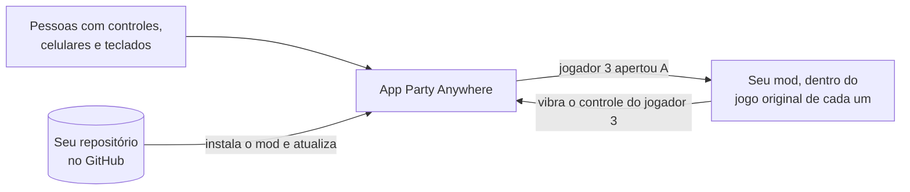

<p align="center">
  <picture>
    <source media="(prefers-color-scheme: dark)" srcset="assets/brand/logo-stacked-dark.png">
    
  </picture>
</p>

<p align="center"><b>Qualquer jogo. Qualquer controle. Até 10 pessoas no mesmo sofá.</b></p>

<p align="center">
  <a href="#jogar">Jogar</a> ·
  <a href="#transformar-um-jogo-em-co-op-local">Transformar um jogo</a> ·
  <a href="#perguntas-rápidas">Perguntas</a> ·
  <a href="#colaborar">Colaborar</a>
</p>

---

## O que é

Juntar a galera para jogar no PC costuma dar trabalho: falta controle, um não conecta, o jogo só tem co-op
online. O **Party Anywhere** resolve isso. É um app para Windows que coloca todo mundo num lobby só e abre
jogos (e mods co-op feitos pela comunidade) para todos jogarem juntos no mesmo PC:

- 🎮 **Controle** com fio ou Bluetooth: liga e já entra.
- 📱 **Celular**: escaneia um QR e vira controle. Sem instalar nada.
- ⌨️ **Teclado**: até o do notebook vale.

Cada pessoa vira um jogador, de **P1 a P10**, com a sua cor. Depois é só escolher o jogo.

> **Por enquanto, é co-op local:** todo mundo no mesmo lugar, na mesma tela (ou em tela dividida), com os
> celulares no mesmo Wi-Fi do PC. Jogar pela internet não faz parte desta versão.

<p align="center">
  
</p>

## Jogar

1. Baixe e instale o **`PartyAnywhere-X.Y.Z-setup.exe`** (a versão mais nova) na página de [Releases](../../releases).
   Se o Windows mostrar "O Windows protegeu o computador", é porque o instalador ainda não tem assinatura
   digital: clique em **Mais informações** → **Executar assim mesmo**.
2. Abra o app. Ligue os controles ou escaneie o QR com o celular (no mesmo Wi-Fi do PC).
3. Vá em **Biblioteca**, escolha o jogo e aperte **Jogar**.

Pronto. O app se atualiza sozinho e avisa quando um jogo ganha versão nova.

<p align="center">
  
</p>

| O que você quer | Como funciona |
|---|---|
| Jogar com celulares e teclados um jogo que já aceita vários controles | Abra o jogo pela Biblioteca (Steam, Epic ou qualquer `.exe`): celulares e teclados aparecem para ele como controles de Xbox. |
| Jogar o **mod co-op** que alguém fez para um jogo seu | Biblioteca → **Adicionar** → cole o link do repositório. O app acha o seu jogo, instala o mod e deixa pronto para jogar. |

> **Quantos jogadores, em cada caso.** A maioria dos jogos comuns enxerga **até 4** controles de Xbox: é um
> limite do Windows, não do app. **De 5 a 10 jogadores**, só com um mod co-op (ou num jogo que aceita mais
> controles). E num jogo comum o próprio jogo também lê o teclado do PC: teclado como jogador funciona
> melhor nos mods.

### Instalar um mod: o que acontece

Um mod co-op é o que transforma o jogo, não o jogo em si. Ele roda em cima da **sua cópia** do jogo
original. Ninguém pode distribuir o jogo de outra empresa, nem o autor do mod nem o Party Anywhere. Você cola o
link e o app faz o resto:

1. **Procura o seu jogo** na Steam, na Epic e nos jogos do PC.
2. **Não achou?** Mostra os caminhos: **instalar pela Steam** ou **pela Epic** (o app espera terminar e
   segue sozinho), **ver na loja**, ou **"já tenho"**: você aponta o `.exe` ou a pasta do jogo, venha de
   onde vier (GOG, CD, outra pasta).
3. **Confere a versão** do jogo quando o mod exige uma específica, e diz o que fazer se não for.
4. **Instala o mod** na pasta do jogo, guardando os arquivos originais. Remover o mod devolve tudo como estava.
5. **Pronto:** o jogo aparece na Biblioteca. Apertou **Jogar**, abre já em co-op local.

---

## Transformar um jogo em co-op local

### Para quê

Muitos jogos ótimos têm **co-op só online**, cada pessoa no seu PC, ou são de um jogador só. Um mod co-op
local faz esse jogo rodar com **várias pessoas no mesmo PC**: tela dividida, cada um com um controle ou um
celular, **do jeito que você decidir** (quantos jogadores, como fica a câmera, o que cada um controla).

Você publica o mod num repositório do GitHub. Quem tem o jogo cola o link no app e joga.

> **A ideia em uma frase:** o Party Anywhere cuida das pessoas e dos controles. O seu mod só pergunta: *"o
> que o jogador 3 está apertando?"*



Você não escreve nada de controle, Bluetooth, celular ou lobby. O mod lê os jogadores por um arquivo pronto
(o **SDK**), e o app instala, atualiza e abre.

**O que é com você, e é a parte grande:** fazer o jogo ter os jogadores extras e dividir a tela. Isso muda
de jogo para jogo: num jogo com ferramentas de mod é mais simples; num jogo fechado é engenharia reversa
(achar no jogo onde ficam os jogadores e a câmera). O [guia de co-op local](docs/MOD-COOP-LOCAL.md) mostra
os caminhos, inclusive como aproveitar o multiplayer que o jogo já tem.

### Em 5 passos

#### 1. Pegue a ferramenta `pa`

Baixe o **`pa.exe`** na página de [Releases](../../releases) e coloque numa pasta que esteja no `PATH`.
Ela cria, confere e empacota o mod para você.

#### 2. Crie o projeto do mod

Com o jogo instalado no seu PC:

```bash
pa new meu-mod --name "Meu Mod Co-op" --base-game "nome do jogo"
```

A ferramenta acha o jogo (Steam ou Epic) e já preenche a ficha com ele: o nome, o executável e de onde ele
vem. Assim o app de quem baixar sabe procurar e, se precisar, ajudar a pessoa a instalar. Você ganha:

| Arquivo | Para que serve |
|---|---|
| `party-anywhere.json` | A "ficha" do mod: nome, quantos jogadores, qual é o jogo original, o que copiar para a pasta dele e o controle do celular do jogo (já vem um, com o meio da tela livre). É o que o app lê. |
| `assets/cover.png` | A capa na Biblioteca. Vem uma provisória; troque pela sua (retrato 3:4, arte própria). |
| `sdk/party_anywhere.h` | O SDK: o arquivo que o mod inclui para ler os jogadores. |
| `.github/workflows/release.yml` | Publica cada versão sozinho quando você cria uma tag. |
| `AGENTS.md`, `CLAUDE.md` e `.claude/` | Instruções para agentes de IA (veja abaixo). |

#### 3. Escreva o mod

O mod roda dentro do jogo (por exemplo, uma DLL que o jogo carrega). O jeito de entrar em cada jogo muda, mas
a parte dos jogadores é sempre a mesma: um arquivo só, em C, que funciona em C e C++.

```c
#define PARTY_ANYWHERE_IMPLEMENTATION
#include "party_anywhere.h"

// 1. Conecte ao app, uma vez, quando o jogo abre
pa_game_info info = { sizeof info, "com.voce.meu-mod", "Meu Mod Co-op", 1, 4 };
pa_client *pa;
pa_connect(&info, &pa);

// 2. A cada frame do jogo, leia os jogadores
pa_poll(pa);
for (int jogador = 0; jogador < PA_MAX_SEATS; jogador++) {
    pa_pad pad;
    if (pa_get_pad(pa, jogador, &pad) && (pad.pressed & PA_BTN_A)) {
        // o jogador apertou A: faça o personagem dele pular
        pa_rumble(pa, jogador, 0.8f, 0.8f, 80); // e o controle dele vibra
    }
}
```

Também dá para saber quem entrou ou saiu, o nome e a cor de cada um, mandar um aviso para o celular de
alguém e pausar quando um jogador cai. Tudo em [docs/SDK.md](docs/SDK.md).

**O controle no celular do seu jogo:** monte no app (Controles → Criar layout), com o nome de cada botão
("Pular", "Impulso") e modos se o jogo muda os comandos (a pé e no carro), e copie para a ficha. Quando o mod
abre, os celulares trocam sozinhos para ele. Como fazer: [docs/GAME-MANIFEST.md](docs/GAME-MANIFEST.md).

#### 4. Teste com o app aberto

Abra o Party Anywhere, entre com um controle e um celular e abra o jogo com o mod. Antes de publicar:

```bash
pa validate
```

Ele confere a ficha e a capa e diz, em português, o que ajustar. Para jogar o seu mod **sem publicar**,
gere o pacote e leve a pasta para a Biblioteca:

```bash
pa pack --from build
```

```bash
pa add .
```

#### 5. Publique (opcional, mas faz o seu mod chegar a todo mundo)

1. Suba o projeto para um repositório **público** no GitHub (só o mod: nada do jogo original).
2. No `release.yml`, troque o passo **Build** pelo jeito de compilar o seu mod.
3. Crie a tag da versão, igual à `version` da ficha:

   ```bash
   git tag v0.1.0
   git push --tags
   ```

4. Adicione o tópico **`party-anywhere-game`** ao repositório (na página dele, em "About").

O GitHub publica a versão sozinho. A partir daí, qualquer pessoa cola o link na Biblioteca e joga, e o seu
mod aparece em **Descobrir**. Versão nova? Suba a `version`, crie a tag nova e quem já instalou recebe o aviso.

### Com um agente de IA

Abra o seu agente (Claude Code, Cursor, Codex e outros) na pasta do mod. **Não precisa configurar nada:** o
projeto traz um `AGENTS.md` que ensina o agente a usar a `pa` e a ler a documentação dela (`pa docs`). Peça
uma coisa de cada vez:

- *"Quero o jogo X em co-op local para 4. Leia o guia de co-op e me proponha o caminho."*
- *"Primeiro passo: o mod carrega no jogo e manda um aviso para o celular."*
- *"Monte o controle do celular deste mod: a pé e no carro."*
- *"Meu mod está pronto para publicar?"*

O agente ajuda de verdade na parte do Party Anywhere (projeto, controles, celular, ficha, publicação) e é um
bom parceiro na parte do jogo, mas essa é feita em idas e voltas com você, testando cada passo. Ele pede sua
permissão antes de instalar qualquer coisa.

<details>
<summary>Agente sem terminal (Claude Desktop e outros): servidor MCP</summary>

A `pa` também é um servidor MCP, com as mesmas ferramentas, rodando no seu PC (sem servidor na internet).
No Claude Code, se preferir:

```bash
claude mcp add --scope user party-anywhere -- pa mcp
```

Em outros agentes, configure um servidor MCP com o comando `pa` e o argumento `mcp`.
</details>

### O que o app exige para achar e instalar o seu mod

O app lê o seu repositório sozinho. O `pa new` já cria tudo assim e o `pa validate` avisa o que faltar:

- [ ] `party-anywhere.json` na raiz do repositório ([como preencher](docs/GAME-MANIFEST.md)), dizendo
      qual é o jogo original (o executável e, se tiver, o código dele na Steam ou na Epic).
- [ ] Capa em retrato (3:4, a partir de 600×800), com arte sua.
- [ ] Cada versão é um release do GitHub com a tag igual à `version` (ex.: `v0.1.0`), com o pacote `.zip` e
      o `party-anywhere.release.json` (o workflow gera os dois).
- [ ] Repositório público, com o tópico `party-anywhere-game`.
- [ ] **Nenhum arquivo do jogo original** no repositório ou no pacote.
- [ ] Nada de jogos com anti-cheat (contornar anti-cheat pode banir quem joga).

Na hora de instalar, o app confere tudo. Se algo não bater, nada é instalado e a mensagem diz o que fazer.

> **E um jogo novo?** Também dá: `pa new meu-jogo --name "Meu Jogo"` (sem `--base-game`) cria um jogo que
> já nasce co-op local. Ele vem inteiro no pacote, sem precisar de outro jogo.

---

## Perguntas rápidas

**Preciso ter o jogo original para jogar um mod?** Sim: o mod roda em cima da sua cópia. O app procura na
Steam e na Epic e, se não achar, ajuda a instalar ou deixa você apontar a pasta.

**Comprei o jogo fora da Steam e da Epic. Funciona?** Funciona: escolha o `.exe` ou a pasta do jogo quando o
app pedir. Se o mod exigir uma versão específica, o app avisa.

**Preciso pagar ou manter um servidor?** Não. O app, a `pa` e o MCP rodam no seu PC, e o GitHub hospeda
os mods de graça.

**Funciona pela internet?** Não. É co-op local: todo mundo no mesmo lugar, celulares no mesmo Wi-Fi do PC.

**Quantos jogadores?** De 1 a 10. O mod diz quantos aceita na ficha; se tiver mais gente, o app pergunta
quem vai jogar.

**Que linguagem posso usar?** C e C++ (`party_anywhere.h`) e C# (`PartyAnywhere.cs`, para Unity com BepInEx
ou MelonLoader). O `pa new` traz os dois.

**Os celulares têm atraso?** Pouco: na rede de casa, o toque chega ao PC em cerca de 25 ms.

**Posso fazer mod de qualquer jogo?** De jogos sem anti-cheat, e sem distribuir arquivos do jogo original.

**É seguro instalar um mod?** Um mod é um programa: ele roda no seu PC, dentro do jogo. Instale só de quem
você confia, como faria com qualquer mod. O app confere que o pacote é exatamente o publicado (pelo hash),
só grava na pasta do jogo e na do próprio app, guarda os arquivos originais e devolve tudo ao remover.
Achou um mod malicioso? Abra uma issue com o link.

---

## Colaborar

Toda ajuda é bem-vinda, de quem joga e de quem programa.

- **Publicou um mod?** Com o tópico `party-anywhere-game` ele já aparece em **Descobrir**. Quer divulgar?
  Abra uma issue com o link.
- **Achou um problema?** Abra uma issue contando o que fez, o que esperava e o que aconteceu.
- **Tem uma ideia?** Abra uma issue: as próximas prioridades saem do que as pessoas pedem.
- **Quer mexer no código?** Faça um fork, crie um branch e abra um pull request.

Combinados: textos do app e docs em português do Brasil; código e commits em inglês. Mudou o protocolo do
celular, o SDK ou a ficha do jogo? Atualize o doc no mesmo pull request.

<details>
<summary><b>Desenvolver o app</b></summary>

Requisitos: Windows 10 ou 11, Rust estável e Node 22 (só para gerar o instalador).

```bash
cargo run -p party-anywhere-hub
```

A interface também abre no navegador, em modo demonstração (com o painel "Demo" para simular celulares e
controles):

```bash
python -m http.server 5173 --directory apps/hub/ui
```

Testes, antes de abrir um pull request:

```bash
cargo test --workspace
```

```bash
cargo clippy --workspace --all-targets -- -D warnings
```

A `pa` direto do código:

```bash
cargo install --path crates/pa-cli
```

Gerar o instalador (sai em `target/release/bundle/nsis/`), dentro de `apps/hub/src-tauri`:

```bash
npx --yes @tauri-apps/cli@2 build
```

Uma tag `vX.Y.Z` publica o instalador e a `pa` pelo workflow `.github/workflows/release.yml`.

| Pasta | O que tem |
|---|---|
| `apps/hub` | O app (Tauri 2): `src-tauri` em Rust, `ui` em HTML e JS |
| `crates/` | Lobby, celular, controles virtuais, SDK, ficha do jogo, Biblioteca e a `pa` |
| `sdk/c` | O `party_anywhere.h` e o exemplo |
| `templates/game` | O projeto modelo que o `pa new` cria |
| `schema/` | O esquema da ficha (autocompletar no editor) |
| `assets/brand` | Marca: mascote, ícone do app e a logo empilhada e deitada, para fundo escuro e claro |

</details>

## Licença

[MIT](LICENSE).
